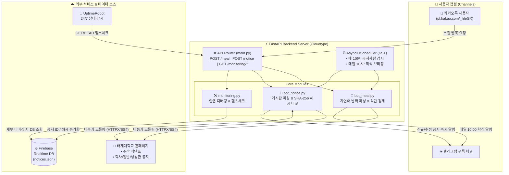

<div align="center">

# 🎓 배재대 알리미 (PCU Bot)
**배재대학교 학우들을 위한 학식 식단 조회 & 교내 공지사항 실시간 알림 통합 챗봇**

[](http://pf.kakao.com/_hIeGX)

<br/>


</div>

---

## 📖 프로젝트 소개 (Overview)

**배재대 알리미(PCU Bot)**는 학교 홈페이지에 매번 접속해야 하는 번거로움을 줄이기 위해 개발된 **배재대학교 맞춤형 캠퍼스 라이프 챗봇 서버**입니다.

하나의 **FastAPI 비동기 서버**에서 두 가지 핵심 채널을 동시에 지원합니다:
1. **💬 카카오톡 챗봇 (`카카오 i 오픈빌더`)**: 언제든 학식 메뉴와 최신 공지사항을 대화형으로 즉시 조회
2. **✈️ 텔레그램 알림 봇 (`Telegram Bot API`)**: 새로운 공지사항 등록·수정 감지 알림 및 매일 오전 10시 오늘의 학식 자동 브로드캐스팅

> 🔗 **지금 바로 사용해 보세요!**  
> 👉 **[배재대 알리미 카카오톡 채널 추가하기](http://pf.kakao.com/_hIeGX)**

---

## 💬 주요 동작 프리뷰 (Showcase)

> 아래 메뉴와 공지 제목은 응답 형식을 보여주기 위한 예시입니다.

<table>
<tr>
<td width="50%" valign="top">

### 🍱 1. 자연어 학식 조회 & 일일 브리핑
`"오늘 학식"`, `"내일 점심"`, `"다음주 수요일"`, `"7/21"` 등 일상적인 표현을 모두 인식합니다.

```text
👤 사용자: "내일 점심 뭐 나와?"

🤖 배재대 알리미:
🌟 11/10(화요일) 배재대 학식 메뉴

▪️ 중식[한식/11:00~13:30]
백미밥
순두부찌개
제육볶음
계란말이
배추김치

▪️ 중식[일품/11:00~13:30]
등심돈까스 & 소스
크림스프
단무지/배추김치
```

</td>
<td width="50%" valign="top">

### 📢 2. 공지사항 신규 등록 & 수정 감지
단순 새 글 알림뿐만 아니라, **기존 공지의 제목이 수정되었을 때 전/후 차이를 비교**하여 알려줍니다.

```text
✈️ [텔레그램 실시간 푸시 알림]

🔔새 공지! [배재대 학사공지]

제목: 2026학년도 2학기 기말고사 일정 안내
링크: https://www.pcu.ac.kr/kor/article/Haksa_1/...

───────────────────

✏️공지 업데이트됨! [생활관 일반공지]

❌ 이전: 동계방학 생활관 입사 신청 안내
⭕ 현재: [기간연장] 동계방학 생활관 입사 신청 안내
🔗 링크: https://www.pcu.ac.kr/article/pitel_notice/...
```

</td>
</tr>
</table>

---

## ✨ 핵심 기술 및 기능 (Key Features)

### 1️⃣ 지능형 학식 크롤러 & 스케줄러 (`bot_meal.py`)
* **자연어 날짜 계산 엔진**: KST(한국 표준시)를 기준으로 상대적 날짜(`오늘`, `내일`, `모레`, `다음주 월요일`)와 절대적 날짜(`YYYY-MM-DD`, `M/D`, `M월 D일`)를 분석해 학교 식단표의 주차 오프셋(`?food=week_diff`)을 자동으로 계산합니다.
* **데이터 노이즈 제거**:
  * 원산지 표기 괄호, 칼로리(`kcal`) 텍스트를 정규표현식으로 깔끔하게 제거합니다.
  * 분식 코너의 상시 중복 메뉴(라면 등) 및 운영하지 않는 코너를 필터링하여 가독성을 극대화했습니다.
* **스마트 텔레그램 발송 (`매일 10:00 KST`)**:
  * 주말이거나 식단표가 아직 `'준비중'` 상태일 때는 불필요한 빈 알림이 가지 않도록 **자동 스킵(Skip)** 로직이 적용되어 있습니다.

### 2️⃣ SHA-256 해시 기반 공지사항 감시 엔진 (`bot_notice.py`)
* **4대 핵심 게시판 10분 주기 감시**:
  * `배재대 학사공지` / `배재대 일반공지` / `생활관 일반공지` / `생활관 입퇴사공지`
* **이중 트래킹 (일반 공지 + 상단 고정 공지)**:
  * 번호가 매겨지는 일반 게시글(`latest_regular_id`)과 상단 고정 공지(`fixed_ids`)를 분리 추적하여 누락 없는 알림을 보장합니다.
* **SHA-256 해시 비교를 통한 수정 감지**:
  * 조회수 변동으로 인한 오탐을 막기 위해 게시글 **제목**을 `SHA-256` 해시로 변환하여 **Firebase Realtime Database**에 저장합니다.
  * 해시값이 바뀌면 기존 제목과 새 제목을 비교하여 수정 알림을 발송합니다.
* **카카오톡 ListCard UI 응답**:
  * 챗봇에서 게시판 선택 시 최신 공지 4개를 원문 바로가기 링크가 포함된 리스트카드로 반환합니다.

### 3️⃣ 무중단 모니터링 & 인앱 디버깅 (`monitoring.py`)
* **인앱 히든 디버깅 커맨드**: 서버 콘솔에 접속하지 않아도 카카오톡 채팅창에 `"디버깅"`, `"hc"`, `"헬스체크"` (또는 `"세부 디버깅"`)를 입력하면 실시간 크롤러 상태와 Firebase DB 데이터를 즉시 점검할 수 있습니다.
* **UptimeRobot 연동**: `/`, `/monitoring/health`, `/monitoring/status` 엔드포인트를 통해 서버 가동 시간(Uptime)과 헬스 상태를 상시 모니터링합니다.

---

## 🏗️ 시스템 아키텍처 (System Architecture)



---

## 📂 디렉토리 구조 (Directory Structure)

```text
pcu_bot/
├── .github/workflows/
│   └── deploy.yml          # GitHub Actions -> Cloudtype 자동 배포 파이프라인
├── main.py                 # FastAPI 애플리케이션, Lifespan 스케줄러 및 라우터 정의
├── config.py               # 환경변수 및 타겟 게시판 URL 등 전역 설정 관리
├── bot_meal.py             # 학식 크롤링, 자연어 날짜 분석, 텔레그램 학식 발송 모듈
├── bot_notice.py           # 공지사항 크롤링, SHA-256 해시 생성/비교, 텔레그램 공지 발송 모듈
├── database.py             # Firebase Realtime Database REST API 연동 모듈
├── monitoring.py           # 서버 헬스체크 라우터 및 챗봇 인앱 디버깅 리포트 생성기
├── utils.py                # KST(한국 표준시) 변환 및 카카오 엔티티 날짜 파싱 유틸리티
└── requirements.txt        # 프로젝트 의존성 패키지 목록
```

---

## 🔌 API 명세 (API Endpoints)

| Method | Endpoint | 역할 | 응답 형식 |
| :---: | :--- | :--- | :--- |
| `GET`/`HEAD` | `/` | 기본 서버 생존 확인 | `{"status": "OK", ...}` |
| `GET`/`HEAD` | `/monitoring/health` | 헬스체크 및 KST 서버 시각 반환 | `{"status": "ok", "timestamp": "..."}` |
| `GET`/`HEAD` | `/monitoring/status` | 앱 버전, 상태(`HEALTHY`), 총 가동시간(`uptime`) 반환 | JSON |
| `POST` | `/meal` | 카카오톡 **학식 조회** 스킬 웹훅 | Kakao Skill v2.0 (`simpleText`) |
| `POST` | `/notice` | 카카오톡 **공지사항 조회** 스킬 웹훅 | Kakao Skill v2.0 (`listCard`) |
| `POST` | `/search` | 카카오톡 **공지 제목 검색** 스킬 웹훅 | Kakao Skill v2.0 (`listCard`, `simpleText`) |

---

### 카카오톡 검색과 다음 주 식단 알림

- `공지:도서관`은 배재대 학사·일반 공지와 생활관 일반·입퇴사 공지의 사이트 제목 검색을 실행하고, 검색 결과 첫 페이지에서 최대 5개의 원문 링크를 보여줍니다.
- 오픈빌더에 사용자 발화가 `검색`인 전용 블록을 만들고, 검색 스킬(`POST /search`)을 연결합니다. 필수 파라미터 `search_query`에 `@sys.text`를 지정하고, 되묻기 문구는 `검색할 공지 키워드를 입력해 주세요. 예: 장학금`로 설정합니다. 직접 전달된 콜론 명령과 `/meal`·`/notice`로 들어온 검색도 처리합니다.
- 다음 주 식단은 한국 시간 기준 매일 오전 10시에 확인합니다. 실제 메뉴가 올라오면 기존 Telegram 채팅으로 알리고, Firebase의 `next_meal_alert`에 발송한 주의 월요일 날짜를 기록합니다. 첫 배포 때 이미 다음 주 메뉴가 올라와 있으면 첫 확인 때 알림을 보냅니다. 기존 Firebase 인증정보에 이 경로의 읽기·쓰기 권한이 필요하며, 새 환경변수는 없습니다.

## 🚀 Windows 로컬 실행

Python 3.12를 사용합니다. PowerShell에서 저장소 루트로 이동한 뒤 실행하세요.

```powershell
python -m venv .venv
.\.venv\Scripts\python.exe -m pip install -r requirements.txt
Copy-Item .env.example .env
```

`.env`에 아래 필수 설정을 채운 뒤 서버를 시작합니다. 이미 설정된 시스템 환경변수가 `.env`보다 우선합니다.
서버 시작 시 누락된 필수 변수의 이름을 표시합니다.

| 환경변수 | 용도 |
| --- | --- |
| `FIREBASE_DB_URL` | 필수. Firebase Realtime Database URL |
| `FIREBASE_SECRET` | 필수. 공지 상태를 읽고 저장하는 Firebase 인증정보 |
| `NOTIFIER_TELEGRAM_TOKEN` | 필수. 학식·공지 알림을 보내는 Telegram 봇 토큰 |
| `CHAT_ID` | 필수. 알림을 받는 Telegram 채팅 ID |
| `PORT` | 선택. 직접 실행 시 기본값은 5000 |

```powershell
.\.venv\Scripts\python.exe main.py
# 또는 로컬 개발용 자동 리로드
.\.venv\Scripts\python.exe -m uvicorn main:app --reload --port 5000
```

서버를 실행하면 스케줄러도 시작됩니다. 로컬 개발에는 테스트용 Firebase와 Telegram 채팅을 사용하세요.

## 🔄 Cloudtype 배포

1. Cloudtype의 `main` 배포환경 시크릿 관리에 `firebase_url`(DB 주소), `firebase`(DB 인증정보), `telegram`(봇 토큰), `id`(채팅 ID)를 등록합니다.
2. [배포 워크플로우](.github/workflows/deploy.yml)는 이 시크릿을 이름으로 참조합니다. GitHub Actions에는 배포 권한용 `CLOUDTYPE_TOKEN`과 `GHP_TOKEN`을 기존 방식대로 등록합니다. Actions 변수 `CLOUDTYPE_PROJECT`에 기존 Cloudtype 대상의 스페이스/프로젝트 경로를 등록합니다.
3. 설정 등록 후 `main`에 반영하면 Actions가 롤링 배포를 요청합니다. 대시보드에서 재배포하는 경우에도 서비스의 환경변수에 같은 시크릿을 연결하고 **배포하기**를 누릅니다.
4. 배포 로그에서 시작이 완료됐는지 확인하고 `GET /monitoring/health`의 응답을 확인합니다.

Cloudtype 서비스 터미널에서 `python -m database`를 실행하면 공지 DB 읽기를 확인할 수 있습니다. HTTP 상태와 게시판 개수를 표시합니다.

Cloudtype 서비스 터미널에서 진단 범위를 선택할 수 있습니다.

| 명령 | 테스트 |
| --- | --- |
| `python -m diagnostics` | 전체 연동. 공지 DB 읽기, 학교 공지 조회, Firebase에 조회 결과 저장·재조회, Telegram 테스트 발송 |
| `python -m diagnostics db` | 운영 공지 DB 읽기 |
| `python -m diagnostics notices` | 학교 게시판의 최신 공지 조회 |
| `python -m diagnostics write` | Firebase의 `diagnostics/<테스트 ID>`에 테스트 데이터 저장·재조회 |
| `python -m diagnostics telegram` | 설정된 채팅으로 Telegram 테스트 메시지 한 건 발송 |

[Cloudtype 환경변수 문서](https://docs.cloudtype.dev/ko/developers/env)

### Telegram 개인 알림 설정

1. Telegram에서 BotFather로 만든 봇과의 개인 채팅을 열고 **시작**을 누르거나 `/start`를 보냅니다.
2. Cloudtype의 `main` 배포환경 시크릿에 아래 값을 등록합니다.

   | Cloudtype 시크릿 | 앱 환경변수 | 입력할 값 |
   | --- | --- | --- |
   | `telegram` | `NOTIFIER_TELEGRAM_TOKEN` | BotFather가 발급한 봇 토큰 |
   | `id` | `CHAT_ID` | 알림을 받을 본인의 Telegram 사용자 ID. 개인 채팅에서는 이 값이 채팅 ID입니다. |

3. `pcu-chatbot`을 재배포하고, 서비스 터미널에서 `python -m diagnostics telegram`을 실행해 개인 채팅에 테스트 알림이 도착하는지 확인합니다.

### 계정 소유자가 교체할 인증정보

| 설정 이름 | 작업 |
| --- | --- |
| `FIREBASE_SECRET` | Firebase에서 기록에 남은 DB 인증정보의 폐기와 교체를 진행하고 새 값을 등록합니다. 기존 방식으로 교체 가능한 자격 증명이 없다면 인증 방식 마이그레이션이 필요합니다. |
| `NOTIFIER_TELEGRAM_TOKEN` | BotFather에서 기존 토큰을 폐기하고 새 토큰을 등록합니다. |
| `NOTICE_TELEGRAM_TOKEN`, `CABANA_TELEGRAM_TOKEN` | 과거에 사용한 봇 토큰을 BotFather에서 폐기합니다. 해당 봇을 운영 중이면 새 토큰으로 교체합니다. |
| `UPTIMEROBOT_API_KEY` | UptimeRobot에서 기록에 남은 키를 폐기하고 사용하는 곳에만 새 키를 등록합니다. |
| `CLOUDTYPE_TOKEN`, `GHP_TOKEN` | Actions에 보관하는 배포용 시크릿입니다. 저장소에서는 이름만 확인됐으며 별도 노출이 확인된 경우 교체합니다. |

`CHAT_ID`는 채팅 식별자입니다. 인증정보를 교체한 뒤에도 과거 Git 기록에 남은 토큰과 비공개 식별자는 별도 정리가 필요합니다.
